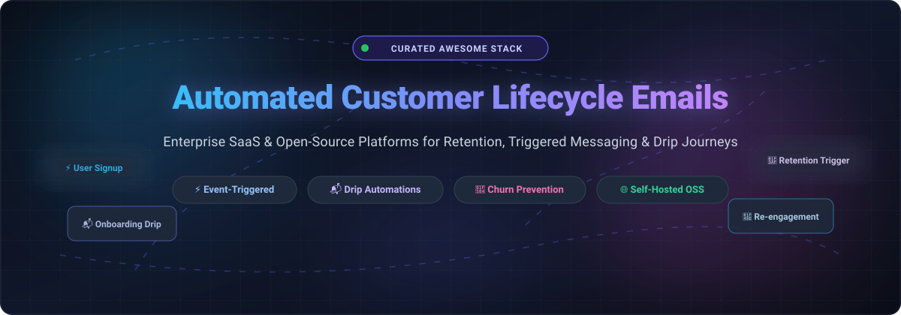
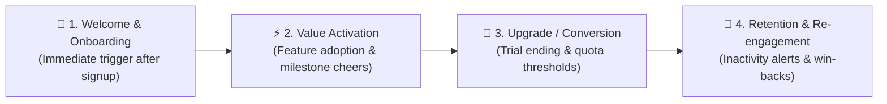

  

# 🚀 Awesome Automated Customer Lifecycle Emails 💌

  
  
  
  
  

> 🎯 A comprehensive, SEO-optimized, and curated directory of top-tier **SaaS platforms**, **open-source marketing automation engines**, and **developer frameworks** for automated customer lifecycle emails, event-triggered notifications, retention drip sequences, and churn reduction campaigns.

---

## 📑 Table of Contents 🧭

- [📊 Sector Overview & Market Dynamics](#-sector-overview--market-dynamics)
- [🏢 SaaS Customer Lifecycle Platforms](#-saas-customer-lifecycle-platforms)
- [💻 Open-Source & Self-Hosted Frameworks](#-open-source--self-hosted-frameworks)
- [✨ Key Lifecycle Email Triggers & Playbooks](#-key-lifecycle-email-triggers--playbooks)
- [📈 Star History](#-star-history)
- [🤝 Contribution Guidelines](#-contribution-guidelines)
- [☕ Support & Sponsorship](#-support--sponsorship)

---

## 📊 Sector Overview & Market Dynamics

The global email marketing and customer lifecycle automation software market is currently valued at **$11.5 billion** and projected to exceed **$22 billion by 2030** at a **15.4% CAGR**, forming a core pillar of the broader **$50+ billion marketing automation ecosystem**. 

The sector exhibits **moderate-to-high fragmentation**: while large incumbents like HubSpot, Twilio SendGrid, and Intuit Mailchimp capture substantial aggregate market share across SMBs and general marketing, vertical specialization prevents a single winner-take-all consolidation—evidenced by Klaviyo's stronghold in e-commerce, Customer.io's leadership in product-led B2B SaaS, and Braze/Iterable's enterprise-grade omnichannel orchestration.

---

## 🏢 SaaS Customer Lifecycle Platforms

| Platform | Company Size (Valuation / Revenue) | Starting Tier Pricing | Free Tier / Trial Limits | Best For / Focus |
|---|---|---|---|---|
| **HubSpot (Marketing Hub)** | **$11.5B – $11.8B market cap** (~$3.13B+ ARR) | **$15/month** (Starter, billed annually; $20/month billed monthly) for 1,000 marketing contacts & 1 seat | **Free-forever tier:** Up to 2 seats, 1,000 static CRM segments, and 2,000 marketing email sends/month (includes HubSpot branding; no multi-step workflows) | Inbound marketing, full CRM integration, and lifecycle lead nurturing |
| **Mailchimp (Intuit)** | **$10B acquisition valuation** (~$1.3B annual revenue) | **$13/month** (Essentials plan for 500 contacts, scaling with volume) | **Free-forever tier:** 250 contacts and 500 email sends/month (daily limit of 250 sends; 1 user seat, pre-built email templates) | SMBs, content creators, and broadcast-oriented newsletters |
| **Klaviyo** | **$5.8B – $6.3B market cap** (~$1.24B ARR; guiding ~$1.53B) | **$20/month** (Starter paid tier for 251–500 active profiles & 5,000 monthly email sends) | **Free-forever tier:** Up to 250 active profiles and 500 email sends/month (includes email support for first 60 days) | E-commerce brands, Shopify stores, and revenue-driven predictive lifecycle campaigns |
| **Braze** | **$5.2B – $5.6B market cap** (~$738M+ ARR) | **Starts at ~$50,000/year** (Entry-level Braze Go edition; annual contract based on MAUs & Action Credits) | **14-day free trial:** Guided product tour and sandbox testing; no permanent free plan | Enterprise cross-channel engagement (mobile push, in-app, SMS, email) |
| **ActiveCampaign** | **$3B valuation** (~$290M ARR) | **$15/month** (Starter tier for 1,000 contacts, billed annually) | **14-day free trial:** Full access to automation builder, CRM features, and templates up to small sandbox limit; no permanent free plan | SMB and mid-market behavioral automations, lead scoring, and sales pipelines |
| **SendGrid (Twilio)** | **$3B acquisition valuation** (~Twilio parent ~$10B+ market cap) | **$15/month** (Marketing Campaigns Basic 5K plan for up to 5,000 contacts & 15,000 sends/month; Email API Starts at $19.95/month) | **60-day free trial:** Capped at 100 emails/day during trial period; no permanent free tier | Developer-friendly transactional email delivery and programmatic lifecycle campaigns |
| **Iterable** | **$2B valuation** (~$200M ARR) | **Starts at ~$30,000/year** (Annual commitment based on active profile count, starting ~100k profiles) | **No free-forever tier & no public free trial:** Enterprise sales demo and bespoke proof-of-concept required | High-growth and enterprise-scale cross-channel journey orchestration |
| **Brevo** | **$1B valuation** (~$218M ARR) | **$9/month** (Starter plan with 5,000 emails/month and unlimited contact storage) | **Free-forever tier:** Unlimited contacts with a send limit of 300 emails/day (includes Brevo watermark) | High-contact / volume-based sending, cost-conscious SMBs, and integrated CRM |
| **Customer.io** | **~$700M valuation** (~$100M ARR) | **$100/month** (Essentials plan for up to 5,000 profiles & 1M emails/month; overages: $0.009/profile, $0.12/1k emails) | **14-day free trial:** Access to visual journey builder and event tracking; also offers 12 months free for early-stage startups (<$10M funding) | Product-led growth (PLG) SaaS, event-driven web/mobile behavioral workflows |
| **Kit (formerly ConvertKit)** | **~$450M valuation** (~$45M ARR) | **$15/month** (Creator plan for up to 300 subscribers with visual automation funnels) | **Free-forever tier:** Up to 10,000 subscribers for broadcast emails and landing pages (automated sequences & funnel builders require paid plans) | Newsletter operators, digital creators, course creators, and solopreneurs |

---

## 💻 Open-Source & Self-Hosted Frameworks

All open-source repositories below are sorted in **descending order by GitHub stargazers**. Each project features an interactive GitHub social star badge linking directly to its stargazer community.

| Project & Stars Badge | Description & Architecture | Primary Use Case |
|---|---|---|
| **[Novu](https://github.com/novuhq/novu)**    | Unified notification infrastructure for engineering teams. Delivers multi-channel workflows across email, SMS, push, chat, and in-app feeds with pre-built UI components and event digests. | Multi-channel product notifications & lifecycle digests |
| **[Chatwoot](https://github.com/chatwoot/chatwoot)**    | Open-source customer engagement suite. Integrates live-chat, email support inbox, conversation continuity, and automated customer communication channels. | Customer support continuity & omni-channel messaging |
| **[Listmonk](https://github.com/knadh/listmonk)**    | Blazing-fast, self-hosted newsletter and mailing list manager packed into a single Go binary with PostgreSQL. Features high-throughput multi-threaded SMTP queues and raw SQL subscriber segmentation. | High-volume newsletters & broadcast email lists |
| **[React Email](https://github.com/resend/react-email)**    | A collection of high-quality, unstyled React components for building clean, modern, and responsive lifecycle email templates using TypeScript and JSX. | Component-driven email template development |
| **[MJML](https://github.com/mjmlio/mjml)**    | Markup language designed to reduce the complexity of coding responsive emails. Its engine transpiles clean, declarative semantic markup into bulletproof, client-tested HTML. | Responsive email template engineering |
| **[Mautic](https://github.com/mautic/mautic)**    | Full-featured, enterprise-grade open-source marketing automation platform. Delivers visual campaign builders, behavioral tracking, lead scoring, and automated multi-stage drip sequences. | Full-suite inbound marketing automation & drip sequences |
| **[Plunk](https://github.com/useplunk/plunk)**    | Open-source email platform built on AWS SES. Combines transactional email APIs, automated drip journeys, and contact management into an intuitive developer-friendly package. | Developer-centric transactional & marketing emails |
| **[Dittofeed](https://github.com/dittofeed/dittofeed)**    | Open-source customer engagement platform and modern alternative to OneSignal and Customer.io. Automates event-driven messages across email, SMS, mobile push, and Slack. | Data-driven event triggers & customer journeys |
| **[Laudspeaker](https://github.com/laudspeaker/laudspeaker)**    | Open-source alternative to Braze and Iterable. Features a no-code visual customer journey builder, event-triggered steps (email, SMS, push), time delays, and native PostHog product analytics integration. | Event-driven product onboarding & user activation |
| **[Keila](https://github.com/pentacent/keila)**    | Privacy-friendly, reliable open-source newsletter management tool built with Elixir and Phoenix. Supports MJML templates, markdown formatting, custom contact attributes, and privacy-respecting metrics. | Privacy-first newsletters & community broadcasts |
| **[Forward Email](https://github.com/forwardemail/forwardemail.net)**    | 100% open-source, encrypted email service for custom domains. Includes outbound SMTP relays, IMAP/POP3 servers, webhooks, and programmatic REST email APIs. | Self-hosted domain email relays & API delivery |

---

## ✨ Key Lifecycle Email Triggers & Playbooks 📚

Every successful automated customer lifecycle system relies on stage-specific behavioral triggers:

1. **👋 Onboarding & Welcome Journey:** Send instant confirmation with next steps, product setup checklist, and guided tours to achieve time-to-value (TTV) within 24 hours.
2. **💡 Activation & Milestone Celebrations:** Trigger notifications when a customer completes their first project, reaches an export milestone, or misses a core product activation step.
3. **⏳ Trial Expiry & Conversion Urgency:** Scheduled nudges sent at T-3 days, T-1 day, and on expiration showcasing ROI, customer success case studies, and upgrade incentives.
4. **💤 Inactivity & Win-Back Campaigns:** Detect dormant user accounts (e.g., 30+ days without login) and trigger personalized feature highlights or reactivation offers.
5. **🛡️ Churn Prevention & Cancellation Surveys:** Capture feedback at the moment of plan downgrade to offer alternatives, pauses, or localized retention discounts.

---

## 📈 Star History

---

## 🤝 Contribution Guidelines 🛠️

Contributions are welcome and greatly appreciated! 🌟 

To propose an addition or update:
1. Ensure the project is actively maintained with clear documentation.
2. For SaaS tools, always provide **specific starting tier pricing** and **granular free tier/trial limits** (avoiding generic placeholders like "Contact Sales").
3. For open-source projects, ensure they provide direct GitHub links with standard repository naming.
4. Fork the repository, create a descriptive feature branch (`git checkout -b feature/new-tool`), and open a Pull Request.

---

## ☕ Support & Sponsorship 💖

Thank you so much for exploring and using **Awesome Automated Customer Lifecycle Emails**! If you found this curated list helpful for your project, team, or business:

- ⭐ **Star** this repository to show your support and help others discover it.
- 🍴 **Fork** it to build your own personal lifecycle stack and cheat sheets.
- 📢 **Share** it on Twitter/X, LinkedIn, and developer communities.
- ☕ **Buy me a coffee / Sponsor:** If you would like to support continuous maintenance and new open-source discoveries, consider sponsoring via the [GitHub Sponsors Dashboard](https://github.com/sponsors/ishandutta2007). Your support is deeply appreciated!
